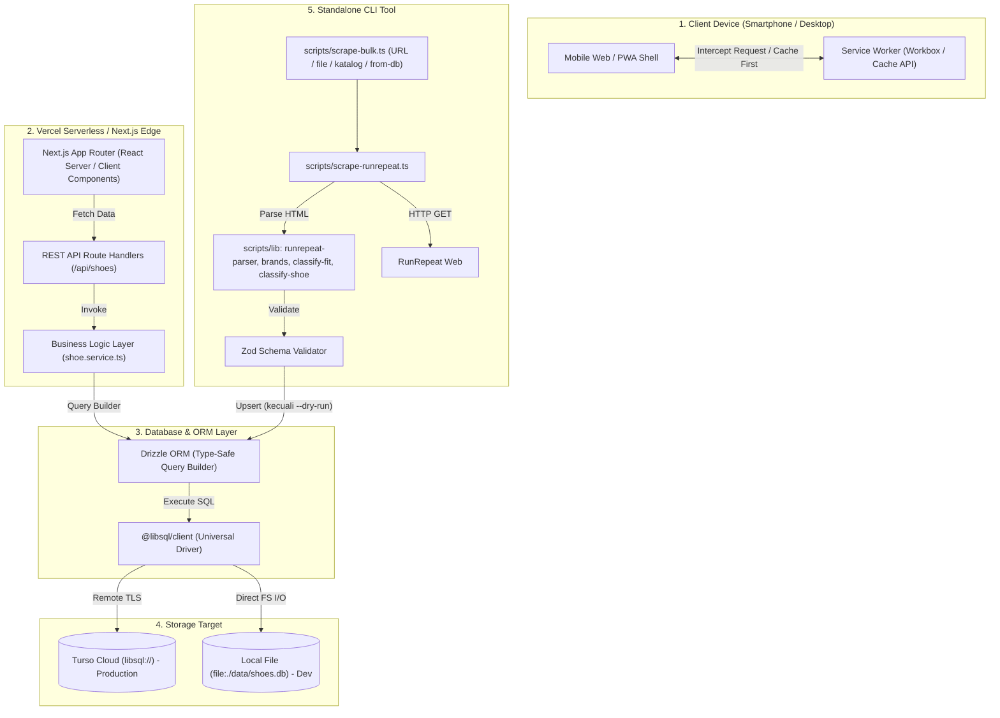

# Dokumentasi Arsitektur & Kode Sistem

Dokumen ini menjelaskan arsitektur teknis, struktur direktori, serta bagaimana setiap komponen teknologi berkomunikasi satu sama lain di dalam proyek **LariYuk (SepatuLariApaIni)**.

---

## 1. Diagram Komunikasi Antar Teknologi



---

## 2. Struktur Direktori Proyek

```
SepatuLariApaIni/
├── package.json              # Dependensi runtime & dev scripts
├── tsconfig.json             # Konfigurasi TypeScript & path alias (@/*)
├── next.config.mjs           # Next.js config + PWA wrapper
├── tailwind.config.ts        # Styling tokens & warna tema rotasi
├── drizzle.config.ts         # Konfigurasi Drizzle Kit untuk migrasi DB
├── .env.example              # Template variabel lingkungan
│
├── public/                   # Aset Statis & PWA
│   ├── manifest.json         # PWA Manifest (nama, icon, background color)
│   ├── sw.js                 # Service worker yang dihasilkan otomatis
│   └── icons/                # Icon resolusi 192x192 & 512x512
│
├── data/                     # Database lokal (SQLite)
│   └── shoes.db              # File SQLite lokal saat pengembangan offline
│
├── scripts/                  # Tool CLI Otomasi
│   ├── scrape-runrepeat.ts   # Scraper satu halaman RunRepeat (+ --dry-run)
│   ├── scrape-bulk.ts        # Scraper bulk: URL / --file / --catalog / --from-db
│   ├── audit-data.ts         # Audit kualitas tabel shoes (read-only)
│   ├── seed-initial.ts       # Seeder 6 sepatu ikonik awal
│   ├── test-db-connection.ts # Script diagnostik koneksi & hitung tabel DB
│   ├── urls.json             # Contoh daftar URL untuk --file
│   ├── lib/
│   │   ├── runrepeat-parser.ts # Parser HTML murni
│   │   ├── brands.ts           # Daftar brand kanonik + splitBrandModel
│   │   ├── classify-fit.ts     # Definisi sizing & breathability
│   │   └── classify-shoe.ts    # Klasifikasi kategori (30 kategori)
│   ├── __tests__/            # Unit test vitest
│   ├── __fixtures__/         # HTML fixture RunRepeat
│   └── README.md             # Panduan scraper, definisi data, bulk mode
│
├── docs/                     # Dokumentasi
│   ├── ARCHITECTURE.md       # (Dokumen ini)
│   ├── PRD.md                # Visi produk awal (sebagian belum dikerjakan)
│   ├── PROJECT_NOTES.md      # Status & patokan pengerjaan
│   └── running-shoe-categories-guide.md # Panduan kategori sepatu
│
└── src/
    ├── types/                # Kontrak Tipe Data TypeScript
    │   └── index.ts          # RunningShoe, ShoeCategory, Specs, Verdict
    │
    ├── data/                 # Static Fallback Dataset
    │   └── fallback-shoes.ts # Dataset cadangan jika DB offline/unreachable
    │
    ├── schemas/              # Validasi Runtime (Zod)
    │   └── shoe.schema.ts    # Validasi skema sebelum masuk DB / API
    │
    ├── db/                   # Konfigurasi & Skema Database
    │   ├── schema.ts         # Definisi tabel SQLite Drizzle
    │   └── index.ts          # Inisialisasi client @libsql universal
    │
    ├── services/             # Lapisan Bisnis & Database Query
    │   └── shoe.service.ts   # getShoes(), getShoeById(), fallback logic
    │
    ├── constants/
    │   ├── categories.ts     # Metadata kategori (label, warna, deskripsi)
    │   └── fit.ts            # Label & warna badge sizing / breathability
    │
    ├── components/           # Komponen UI React (Client Components)
    │   ├── Navbar.tsx        # Header dengan indikator status online/offline
    │   ├── RotationFilter.tsx# Tombol filter kategori scrollable
    │   ├── ShoeCard.tsx      # Kartu ringkasan spesifikasi lab
    │   ├── FitBadges.tsx     # Badge fit & adem/panas
    │   └── ShoeDetailModal.tsx # Bottom sheet detail specs & pros/cons
    │
    └── app/                  # Next.js App Router Layer
        ├── layout.tsx        # Root HTML layout, font, dan meta viewport
        ├── globals.css       # Directives Tailwind CSS
        ├── page.tsx          # Halaman katalog utama
        │
        └── api/              # REST API Endpoints
            └── shoes/
                ├── route.ts         # GET /api/shoes (list & search)
                ├── [id]/
                │   └── route.ts     # GET /api/shoes/:id (detail)
                └── categories/
                    └── route.ts     # GET /api/shoes/categories (metadata)
```

---

## 3. Cara Setiap Teknologi Berkomunikasi

### A. Next.js App Router & REST API
- `src/app/page.tsx` bertindak sebagai *Client Component* (`"use client"`).
- Pada saat komponen dimuat pertama kali (`useEffect`), aplikasi memanggil `fetch('/api/shoes')`.
- API endpoint (`src/app/api/shoes/route.ts`) berjalan di lingkungan serverless. Endpoint ini menerima query parameter (seperti `?category=daily_trainer`, `?search=novablast`, `?sizing=true_to_size`, `?breathability=cool`) dan mendelegasikannya ke `shoe.service.ts`.

### B. Business Service & Drizzle ORM
- `shoe.service.ts` tidak menulis query string mentah, melainkan menggunakan Drizzle query builder:
  ```typescript
  db.select().from(shoes).where(and(...conditions)).orderBy(desc(shoes.releaseYear));
  ```
- Drizzle menjamin *type safety* penuh: jika nama kolom tabel diubah di `schema.ts`, TypeScript langsung mendeteksi error pada saat build sebelum aplikasi dijalankan.
- **Resilience Fallback**: Jika database belum dimigrasikan atau terjadi gangguan jaringan sementara ke Turso Cloud, `shoe.service.ts` menangkap error dan mengalihkan pembacaan ke `FALLBACK_SHOES` (`src/data/fallback-shoes.ts`), menjamin UI tidak pernah crash (*zero downtime*).

### C. Driver Database Universal (`@libsql/client`) & Turso Cloud
- Koneksi diatur di `src/db/index.ts`.
- Driver membaca konfigurasi dari `.env` / `.env.local`:
  - **Turso Cloud (Remote)**: URL berformat `libsql://...` dipasangkan dengan `TURSO_AUTH_TOKEN`. Driver membuka koneksi HTTPS/WebSocket aman ke Turso Cloud di AWS edge.
  - **SQLite Lokal (Offline)**: URL berformat `file:./data/shoes.db`, driver secara otomatis melakukan I/O langsung ke file lokal tanpa memerlukan internet.
- Skema tabel disinkronkan ke cloud atau lokal menggunakan `npm run db:push`, dan diverifikasi statusnya via `npm run db:check`.

### D. Scraper & Definisi Data
- Parser (`scripts/lib/runrepeat-parser.ts`) bersifat murni (HTML → objek) sehingga dapat dites dengan fixture. Brand/model dipisah oleh `brands.ts`; sizing & breathability oleh `classify-fit.ts`; kategori oleh `classify-shoe.ts`.
- Data yang tidak lengkap atau tidak lolos Zod → `NeedsReviewError` (tidak masuk DB). Detail: `scripts/README.md`.
- Penambahan kolom di `src/db/schema.ts` diterapkan dengan `npm run db:push` (tidak ada folder migrasi). Kode yang membaca kolom baru pada DB lama akan jatuh ke dataset fallback sampai skema di-push.

### E. PWA & Service Worker (`@ducanh2912/next-pwa`)
- Konfigurasi diatur dalam `next.config.mjs`.
- Saat build (`npm run build`), Workbox mengompilasi `public/sw.js`.
- Service worker memotong (*intercept*) request jaringan:
  - File HTML, JS, CSS, dan icon disimpan di **Cache API**.
  - Respons API `/api/shoes` disimpan dengan strategi *stale-while-revalidate*.
  - Ketika browser kehilangan koneksi internet (offline), Service Worker melayani data dari cache, dan komponen `Navbar.tsx` secara otomatis menampilkan lencana **"Offline Mode"**.

