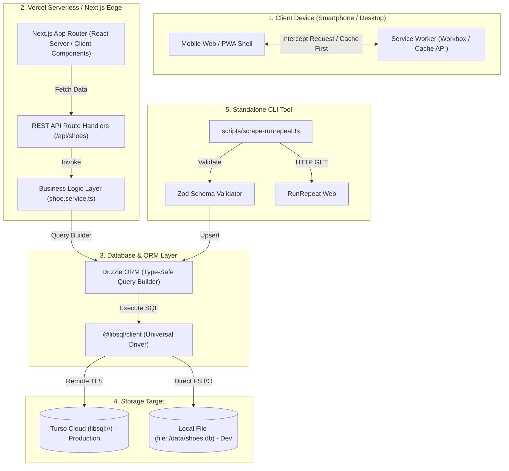

# Dokumentasi Arsitektur & Kode Sistem

Dokumen ini menjelaskan arsitektur teknis, struktur direktori, serta bagaimana setiap komponen teknologi berkomunikasi satu sama lain di dalam proyek **LariYuk (SepatuLariApaIni)**.

---

## 1. Diagram Komunikasi Antar Teknologi



---

## 2. Struktur Direktori Proyek

```
SepatuLariApaIni/
├── package.json              # Dependensi runtime & dev scripts
├── tsconfig.json             # Konfigurasi TypeScript & path alias (@/*)
├── next.config.mjs           # Next.js config + PWA wrapper
├── tailwind.config.ts        # Styling tokens & warna tema rotasi
├── drizzle.config.ts         # Konfigurasi Drizzle Kit untuk migrasi DB
├── .env.example              # Template variabel lingkungan
│
├── public/                   # Aset Statis & PWA
│   ├── manifest.json         # PWA Manifest (nama, icon, background color)
│   ├── sw.js                 # Service worker yang dihasilkan otomatis
│   └── icons/                # Icon resolusi 192x192 & 512x512
│
├── data/                     # Database lokal (SQLite)
│   └── shoes.db              # File SQLite lokal saat pengembangan offline
│
├── scripts/                  # Tool CLI Otomasi
│   ├── scrape-runrepeat.ts   # Scraper halaman lab RunRepeat ke DB
│   ├── seed-initial.ts       # Seeder 6 sepatu ikonik awal
│   └── README.md             # Panduan pengoperasian scraper
│
├── docs/                     # Dokumentasi Arsitektur & Rencana
│   └── ARCHITECTURE.md       # (Dokumen ini)
│
└── src/
    ├── types/                # Kontrak Tipe Data TypeScript
    │   └── index.ts          # RunningShoe, ShoeCategory, Specs, Verdict
    │
    ├── schemas/              # Validasi Runtime (Zod)
    │   └── shoe.schema.ts    # Validasi skema sebelum masuk DB / API
    │
    ├── db/                   # Konfigurasi & Skema Database
    │   ├── schema.ts         # Definisi tabel SQLite Drizzle
    │   └── index.ts          # Inisialisasi client @libsql universal
    │
    ├── services/             # Lapisan Bisnis & Database Query
    │   └── shoe.service.ts   # getShoes(), getShoeById(), metadata kategori
    │
    ├── components/           # Komponen UI React (Client Components)
    │   ├── Navbar.tsx        # Header dengan indikator status online/offline
    │   ├── RotationFilter.tsx# Tombol filter kategori scrollable
    │   ├── ShoeCard.tsx      # Kartu ringkasan spesifikasi lab
    │   └── ShoeDetailModal.tsx # Bottom sheet detail specs & pros/cons
    │
    └── app/                  # Next.js App Router Layer
        ├── layout.tsx        # Root HTML layout, font, dan meta viewport
        ├── globals.css       # Directives Tailwind CSS
        ├── page.tsx          # Halaman katalog utama
        │
        └── api/              # REST API Endpoints
            └── shoes/
                ├── route.ts         # GET /api/shoes (list & search)
                ├── [id]/
                │   └── route.ts     # GET /api/shoes/:id (detail)
                └── categories/
                    └── route.ts     # GET /api/shoes/categories (metadata)
```

---

## 3. Cara Setiap Teknologi Berkomunikasi

### A. Next.js App Router & REST API
- `src/app/page.tsx` bertindak sebagai *Client Component* (`"use client"`).
- Pada saat komponen dimuat pertama kali (`useEffect`), aplikasi memanggil `fetch('/api/shoes')`.
- API endpoint (`src/app/api/shoes/route.ts`) berjalan di lingkungan serverless. Endpoint ini menerima query parameter (seperti `?category=daily_trainer` atau `?search=novablast`) dan mendelegasikannya ke `shoe.service.ts`.

### B. Business Service & Drizzle ORM
- `shoe.service.ts` tidak menulis query string mentah, melainkan menggunakan Drizzle query builder:
  ```typescript
  db.select().from(shoes).where(and(...conditions)).orderBy(desc(shoes.releaseYear));
  ```
- Drizzle menjamin *type safety* penuh: jika nama kolom tabel diubah di `schema.ts`, TypeScript langsung mendeteksi error pada saat build sebelum aplikasi dijalankan.

### C. Driver Database Universal (`@libsql/client`)
- Koneksi diatur di `src/db/index.ts`.
- Pengemudi membaca `process.env.TURSO_DATABASE_URL`:
  - **Di Vercel (Production)**: URL berformat `libsql://...`, driver membuka koneksi HTTPS/WebSocket aman ke Turso Cloud.
  - **Di Laptop (Development)**: URL berformat `file:./data/shoes.db`, driver secara otomatis melakukan I/O langsung ke file lokal tanpa memerlukan internet.

### D. PWA & Service Worker (`@ducanh2912/next-pwa`)
- Konfigurasi diatur dalam `next.config.mjs`.
- Saat build (`npm run build`), Workbox mengompilasi `public/sw.js`.
- Service worker memotong (*intercept*) request jaringan:
  - File HTML, JS, CSS, dan icon disimpan di **Cache API**.
  - Respons API `/api/shoes` disimpan dengan strategi *stale-while-revalidate*.
  - Ketika browser kehilangan koneksi internet (offline), Service Worker melayani data dari cache, dan komponen `Navbar.tsx` secara otomatis menampilkan lencana **"Offline Mode"**.
