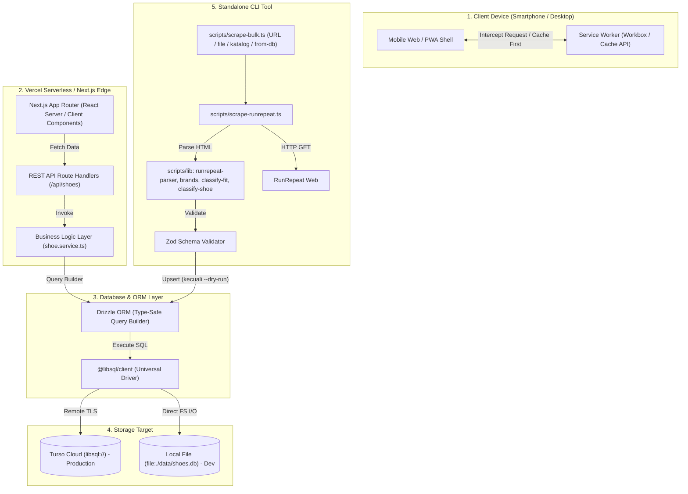

# Dokumentasi Arsitektur & Kode Sistem

Dokumen ini menjelaskan arsitektur teknis, struktur direktori, serta bagaimana setiap komponen teknologi berkomunikasi satu sama lain di dalam proyek **LariYuk (SepatuLariApaIni)**.

---

## 1. Diagram Komunikasi Antar Teknologi



---

## 2. Struktur Direktori Proyek

```
SepatuLariApaIni/
├── package.json              # Dependensi runtime & dev scripts
├── tsconfig.json             # Konfigurasi TypeScript & path alias (@/*)
├── next.config.mjs           # Next.js config + PWA wrapper + remotePatterns gambar (runrepeat, unsplash)
├── tailwind.config.ts        # Styling tokens & warna tema rotasi
├── drizzle.config.ts         # Konfigurasi Drizzle Kit untuk migrasi DB
├── .env.example              # Template variabel lingkungan
│
├── public/                   # Aset Statis & PWA
│   ├── manifest.json         # PWA Manifest (nama, ikon any + maskable, theme #10b981)
│   ├── sw.js, workbox-*.js   # Dihasilkan otomatis saat build (di-gitignore)
│   └── icons/                # icon-192x192.png, icon-512x512.png, icon.svg
│
├── data/                     # Database lokal (SQLite)
│   └── shoes.db              # File SQLite lokal (57 sepatu); *.bak / *.sql = artefak lokal, di-gitignore
│
├── scripts/                  # Tool CLI Otomasi
│   ├── scrape-runrepeat.ts   # Scraper satu halaman RunRepeat (+ --dry-run)
│   ├── scrape-bulk.ts        # Scraper bulk: URL / --file / --catalog / --from-db
│   ├── audit-data.ts         # Audit kualitas tabel shoes (read-only)
│   ├── seed-initial.ts       # Seeder 6 sepatu ikonik awal
│   ├── test-db-connection.ts # Script diagnostik koneksi & hitung tabel DB
│   ├── urls.json             # Contoh daftar URL untuk --file
│   ├── lib/
│   │   ├── runrepeat-parser.ts # Parser HTML murni
│   │   ├── brands.ts           # Daftar brand kanonik + splitBrandModel
│   │   ├── gallery-images.ts   # Parser galeri foto RunRepeat (product/detail/lab) → tabel shoe_images
│   │   ├── vision-embed.ts     # Pembungkus model embedding (transformers.js, Node) untuk script
│   ├── audit-images.ts, embed-catalog.ts, eval-vision.ts  # Audit foto → indeks embedding → evaluasi top-K
│   │   ├── classify-fit.ts     # Definisi sizing & breathability
│   │   └── classify-shoe.ts    # Klasifikasi kategori (30 kategori)
│   ├── __tests__/            # Unit test vitest
│   ├── __fixtures__/         # HTML fixture RunRepeat
│   └── README.md             # Panduan scraper, definisi data, bulk mode
│
├── docs/                     # Dokumentasi
│   ├── ARCHITECTURE.md       # (Dokumen ini)
│   ├── DB-SYNC-TURSO.md      # Sinkronisasi SQLite lokal → Turso (backup, replace, rollback)
│   ├── PRD.md                # Visi produk awal (sebagian belum dikerjakan)
│   ├── adr/ADR-001-ai-vision-scan.md # Keputusan arsitektur AI Vision (BYOK)
│   ├── adr/ADR-002-on-device-shoe-predictor.md # Prediktor on-device + multi-foto (Proposed)
│   ├── PROJECT_NOTES.md      # Status & patokan pengerjaan
│   └── running-shoe-categories-guide.md # Panduan kategori sepatu
│
└── src/
    ├── types/                # Kontrak Tipe Data TypeScript
    │   └── index.ts          # RunningShoe, ShoeCategory, Specs, Verdict
    │
    ├── data/                 # Static Fallback Dataset
    │   └── fallback-shoes.ts # Dataset cadangan jika DB offline/unreachable
    │
    ├── schemas/              # Validasi Runtime (Zod)
    │   └── shoe.schema.ts    # Validasi skema sebelum masuk DB / API
    │
    ├── db/                   # Konfigurasi & Skema Database
    │   ├── schema.ts         # Definisi tabel SQLite Drizzle
    │   └── index.ts          # Inisialisasi client @libsql universal
    │
    ├── services/             # Lapisan Bisnis & Database Query
    │   └── shoe.service.ts   # getShoes(), getShoeById(), fallback logic
    │
    ├── constants/
    │   ├── categories.ts     # Metadata kategori (label, warna, deskripsi)
    │   ├── fit.ts            # Label & warna badge sizing / breathability
    │   └── guide.ts          # Konten halaman /panduan (rotasi, fit, breathability)
    │
    ├── lib/                  # Logika murni (mudah dites, tanpa alias @/)
    │   ├── text.ts           # normalizeName (dipakai scraper & matcher)
    │   ├── compare.ts        # Util banding sepatu (leader, bar, diff, parse ids)
    │   └── vision/           # AI Vision: schema, key, gemini, match-shoe, handler, client
    │
    ├── components/           # Komponen UI React (Client Components)
    │   ├── Navbar.tsx        # Header dengan indikator status online/offline
    │   ├── RotationFilter.tsx# Tombol filter kategori scrollable
    │   ├── ShoeCard.tsx      # Kartu ringkasan spesifikasi lab + thumbnail
    │   ├── ShoeImage.tsx     # next/image dengan fallback ikon
    │   ├── FitBadges.tsx     # Badge fit & adem/panas
    │   ├── ScanShoeSheet.tsx # Bottom sheet Scan (kamera/galeri → hasil/kandidat)
    │   ├── AiSettingsModal.tsx # Modal BYOK: simpan/hapus key Gemini (localStorage)
    │   └── ShoeDetailModal.tsx # Bottom sheet detail specs & pros/cons
    │
    └── app/                  # Next.js App Router Layer
        ├── layout.tsx        # Root HTML layout, metadata, viewport, manifest
        ├── icon.svg, favicon.ico, apple-icon.png  # Ikon app (konvensi Next.js)
        ├── globals.css       # Directives Tailwind CSS
        ├── page.tsx          # Halaman katalog: search, chip kategori, panel Fit & Breathability
        ├── panduan/
        │   └── page.tsx      # Halaman Panduan Filter (3 tab)
        ├── bandingkan/
        │   └── page.tsx      # Banding 2–3 sepatu (?ids=a,b)
        │
        └── api/              # REST API Endpoints
            └── shoes/
                ├── route.ts         # GET /api/shoes (list & search)
                ├── [id]/
                │   └── route.ts     # GET /api/shoes/:id (detail)
                └── categories/
                    └── route.ts     # GET /api/shoes/categories (metadata)
            └── detect-shoe/
                └── route.ts         # POST /api/detect-shoe (AI Vision, no-store)
```

---

## 3. Cara Setiap Teknologi Berkomunikasi

### A. Next.js App Router & REST API
- `src/app/page.tsx` bertindak sebagai *Client Component* (`"use client"`).
- Pada saat komponen dimuat pertama kali (`useEffect`), aplikasi memanggil `fetch('/api/shoes')`.
- Pemfilteran di UI dilakukan **client-side** atas seluruh hasil `/api/shoes` (pencarian, kategori cocok ke `category` atau `subCategory`, Fit, Breathability); query param API tetap tersedia untuk klien lain.
- API endpoint (`src/app/api/shoes/route.ts`) berjalan di lingkungan serverless. Endpoint ini menerima query parameter (seperti `?category=daily_trainer`, `?search=novablast`, `?sizing=true_to_size`, `?breathability=cool`) dan mendelegasikannya ke `shoe.service.ts`.

### B. Business Service & Drizzle ORM
- `shoe.service.ts` tidak menulis query string mentah, melainkan menggunakan Drizzle query builder:
  ```typescript
  db.select().from(shoes).where(and(...conditions)).orderBy(desc(shoes.releaseYear));
  ```
- Drizzle menjamin *type safety* penuh: jika nama kolom tabel diubah di `schema.ts`, TypeScript langsung mendeteksi error pada saat build sebelum aplikasi dijalankan.
- **Resilience Fallback**: Jika database belum dimigrasikan atau terjadi gangguan jaringan sementara ke Turso Cloud, `shoe.service.ts` menangkap error dan mengalihkan pembacaan ke `FALLBACK_SHOES` (`src/data/fallback-shoes.ts`), menjamin UI tidak pernah crash (*zero downtime*).

### C. Driver Database Universal (`@libsql/client`) & Turso Cloud
- Koneksi diatur di `src/db/index.ts`.
- Driver membaca konfigurasi dari `.env` / `.env.local`:
  - **Turso Cloud (Remote)**: URL berformat `libsql://...` dipasangkan dengan `TURSO_AUTH_TOKEN`. Driver membuka koneksi HTTPS/WebSocket aman ke Turso Cloud di AWS edge.
  - **SQLite Lokal (Offline)**: URL berformat `file:./data/shoes.db`, driver secara otomatis melakukan I/O langsung ke file lokal tanpa memerlukan internet.
- Skema tabel disinkronkan ke cloud atau lokal menggunakan `npm run db:push`, dan diverifikasi statusnya via `npm run db:check`. Untuk menyalin **data** lokal ke Turso, lihat `docs/DB-SYNC-TURSO.md`.

### D. Scraper & Definisi Data
- Parser (`scripts/lib/runrepeat-parser.ts`) bersifat murni (HTML → objek) sehingga dapat dites dengan fixture. Brand/model dipisah oleh `brands.ts`; sizing & breathability oleh `classify-fit.ts`; kategori oleh `classify-shoe.ts`.
- Data yang tidak lengkap atau tidak lolos Zod → `NeedsReviewError` (tidak masuk DB). Detail: `scripts/README.md`.
- Penambahan kolom di `src/db/schema.ts` diterapkan dengan `npm run db:push` (tidak ada folder migrasi). Kode yang membaca kolom baru pada DB lama akan jatuh ke dataset fallback sampai skema di-push.

### E. Gambar Produk
- `ShoeImage.tsx` memakai `next/image` (`fill`, `object-contain`) dengan `imageUrl` dari RunRepeat. Hostname harus terdaftar di `images.remotePatterns` (`next.config.mjs`). Bila URL kosong atau `onError`, tampil ikon `Footprints`.

### F. AI Vision Scan (`/api/detect-shoe`)
```
Browser (resize 1024px JPEG, key dari localStorage)
   └─ POST /api/detect-shoe  (header x-gemini-key)
        └─ handleDetect (src/lib/vision/handler.ts)
             ├─ resolveApiKey: BYOK → (dev saja) GEMINI_API_KEY → 401
             ├─ validasi Zod (mime, ukuran)
             ├─ Gemini 2.5 Flash (REST, JSON terstruktur)
             └─ matchShoe → katalog `shoes` (fuzzy, di memori)
```
- Key dikirim via header (bukan URL) ke Gemini (`x-goog-api-key`) dan tidak pernah dilog/disimpan. Keputusan & alternatif: `docs/adr/ADR-001-ai-vision-scan.md`.
- POST tidak di-cache Service Worker (hanya GET); saat offline UI menampilkan pesan khusus.

### G. PWA & Service Worker (`@ducanh2912/next-pwa`)
- Konfigurasi diatur dalam `next.config.mjs`.
- Saat build (`npm run build`), Workbox mengompilasi `public/sw.js`.
- Service worker memotong (*intercept*) request jaringan:
  - File HTML, JS, CSS, dan icon disimpan di **Cache API**.
  - Respons API `/api/shoes` disimpan dengan strategi *stale-while-revalidate*.
  - Ketika browser kehilangan koneksi internet (offline), Service Worker melayani data dari cache, dan komponen `Navbar.tsx` secara otomatis menampilkan lencana **"Offline Mode"**.

